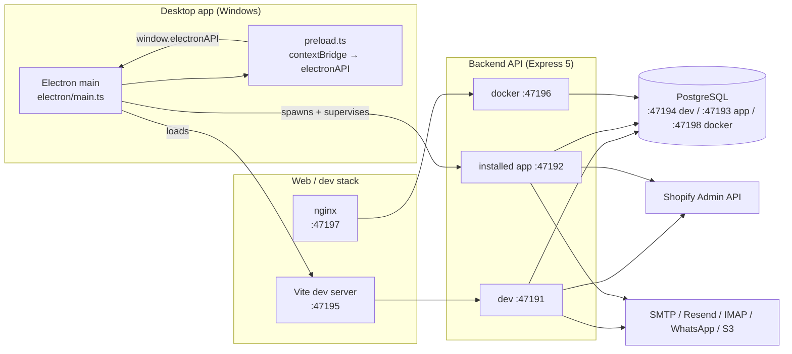
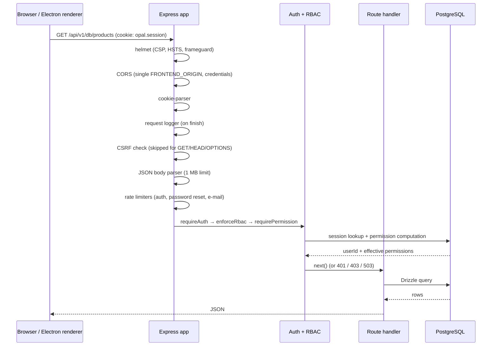
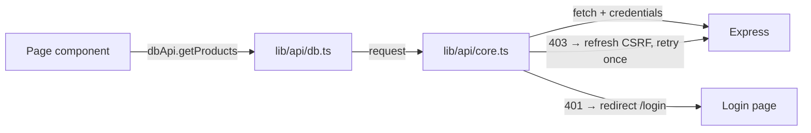
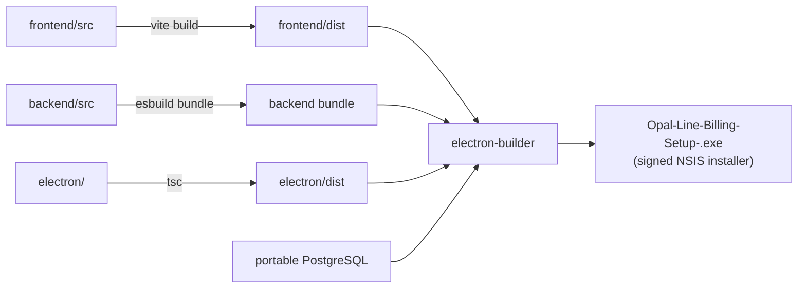

# Architecture

How Opal Line Billing is put together: the repository layout, the three ways it
runs, the lifecycle of a request, the shape of the database, and the seams
between modules.

This document describes the system as it is **today**. Where a decision has a
reason behind it that is not obvious from the code, the reason is written down
so the next change does not have to rediscover it.

---

## 1. System in one picture

Opal Line Billing is a jewellery-billing ERP. A single shop sells silver
jewellery: it prices goods against the daily silver rate, bills customers with
GST, tracks stock across locations, buys from suppliers, keeps double-entry
books, and syncs the shop's catalogue and orders with Shopify.



**Key idea:** the Electron shell is only a window, a printer and an updater. All
business logic lives in the Express backend, which is byte-for-byte the same
process in the desktop app, in the dev stack and in Docker. Anything the UI can
do over HTTP, the desktop app can do too — which is why the Playwright suite
runs unchanged against the installed binary.

---

## 2. Repository layout

```
backend/            Express + Drizzle + PostgreSQL API
  src/
    index.ts        app assembly: middleware order, CSRF, static/SPA, routes
    routes/         one router per domain (db, auth, dashboard, reports, …)
    db/             schema.ts (53 tables), bootstrap.ts, migrate.ts, seed.ts
    lib/            pure helpers with unit tests (pricing, ranges, crypto)
    *.ts            domain modules (shopify, purchases, stock, notifications…)
  drizzle/          generated SQL migrations
frontend/           React 19 + Vite 8 + Tailwind 4 UI
  src/
    pages/          one file per route (63 pages)
    components/ui/  the design-system primitives
    components/     feature components (dialogs, charts, layout, shopify)
    lib/api/        typed API client, one module per backend domain
    auth/           AuthProvider + context
    types/          shared TypeScript types
electron/           main process, preload bridge, print, log rotation, updater
e2e/                Playwright specs (68 tests across 9 spec files)
scripts/            build, packaging, maintenance and audit utilities
docs/               this documentation set
```

### Module boundaries

| Layer | Depends on | Never does |
|---|---|---|
| `frontend/src/pages` | `components/`, `lib/api`, `auth`, `types` | Talk to `fetch` directly; hold business rules |
| `frontend/src/components` | `components/ui`, `lib/` | Import a page |
| `frontend/src/lib/api` | `lib/api/core` | Contain UI logic; throw raw `fetch` errors at the UI |
| `backend/src/routes` | domain modules, `rbac`, `sessions`, `db` | Write raw SQL strings instead of Drizzle |
| `backend/src/*.ts` (domain) | `db`, `lib`, `logger` | Import from `routes/` (the dependency points one way) |
| `backend/src/db` | nothing above it | Import request objects |
| `electron/` | nothing from `backend/` or `frontend/` | Start the backend twice |

The one deliberate exception is `backend/src/db/bootstrap.ts`, which is large
(≈1 800 lines) and owns DDL for tables that Drizzle's `push` cannot express
(triggers, partial indexes, seed roles). It is called once at boot.

---

## 3. Runtime topologies

### 3.1 Development

`npm run dev` runs `scripts/dev.mjs`, which provisions a **dev-only**
PostgreSQL cluster on **47194** (data under `%APPDATA%/Opal Line Billing Dev`),
writes `backend/.env`, then starts the backend on **47191** and Vite on
**47195**.

The dev stack is fully isolated from the installed desktop app: separate
clusters, separate data directories, separate encryption keys, separate
sessions. Logging into the dev UI never logs the desktop app out.

### 3.2 Installed desktop app

The installer is self-contained — no Node.js, no PostgreSQL, no admin rights on
the target machine.

| Piece | Detail |
|---|---|
| Backend | Express run via Electron's Node (`ELECTRON_RUN_AS_NODE`) on **47192** |
| Database | Portable PostgreSQL 16.4 in `%APPDATA%\Opal Line Billing\pgdata`, port **47193** |
| UI | Built React bundle served by the backend from `resources/frontend/dist` |
| Data | `%APPDATA%\Opal Line Billing` — pgdata, logs, backups, uploads, `.encryption-key` |
| Installer | `%LOCALAPPDATA%\Programs\Opal Line Billing` |

Uninstalling keeps user data (`deleteAppDataOnUninstall: false`).

### 3.3 Docker / self-hosted

`docker-compose.yml` runs three services: the backend (listens on 4000 inside
the container, published as **47196**), nginx serving the built frontend
(**47197**), and PostgreSQL (**47198**). The backend reaches the database over
the compose network (`DATABASE_URL=…@db:5432`).

### 3.4 The port block

Opal Line reserves **47191–47198** so the dev stack, the installed app and a
Docker deployment can coexist on one machine without colliding with other
software's default ports.

| Port | Owner |
|---|---|
| 47191 | Backend API, dev stack |
| 47192 | Backend API, installed desktop app |
| 47193 | PostgreSQL, installed desktop app |
| 47194 | PostgreSQL, dev stack |
| 47195 | Vite dev server (the UI in development) |
| 47196 | Backend, Docker |
| 47197 | Frontend (nginx), Docker |
| 47198 | PostgreSQL, Docker (container listens on 5432) |

---

## 4. Request lifecycle

`backend/src/index.ts` assembles the app. **Middleware order is the security
contract** — reordering it silently weakens the app.



### The guards, in order

| Guard | Where | What it does |
|---|---|---|
| `csrfProtection` | `index.ts` | Rejects state-changing requests without a valid `X-CSRF-Token`. Public auth paths and the Shopify webhook are exempt. |
| `requireAuth` | `sessions.ts` | Resolves the session cookie to a user id; enforces the forced-password-change flag. |
| `enforceRbac` | `rbac.ts` | Maps the first path segment to a module and checks `view`/`create`/`edit`/`delete` by HTTP method. |
| `requirePermission(module, action)` | `rbac.ts` | Explicit per-route check — the authoritative one. |

`enforceRbac` is a coarse net over `/api/v1/db/*`; every business route also
carries its own `requirePermission(...)`, and that explicit check is the one
that must be correct.

### Response conventions

- Success: `2xx` with a JSON body. Lists return `{ data: T[], total: number }`.
- Validation failure: `400` with `{ error, details }` (field errors from Zod).
- Not authenticated: `401` `{ error: 'Not authenticated' }`.
- Forbidden: `403` `{ error: 'Access denied' }`.
- Database unreachable: `503` — never a silent `200` with empty data.
- Unhandled error: `500` `{ error: 'Internal server error' }`; the stack is
  logged, never returned.

---

## 5. Data layer

### 5.1 Schema

`backend/src/db/schema.ts` defines **53 tables** with Drizzle. The domain
groups:

| Group | Tables |
|---|---|
| Identity | `users`, `roles`, `sessions`, `login_attempts`, `rate_limit_hits` |
| Catalogue | `products`, `batches`, `boms`, `bom_items`, `karigars`, `branches`, `currencies` |
| Parties | `customers`, `suppliers` |
| Sales | `sales_orders`, `sales_invoices`, `sales_invoice_items`, `sales_returns`, `quotations`, `quotation_items`, `order_events`, `shipments` (bookings are rows in `sales_orders` with a booking type) |
| Purchase | `purchase_orders`, `purchase_order_items`, `purchase_invoices`, `purchase_invoice_items`, `purchase_returns`, `purchase_return_items`, `supplier_payments`, `supplier_payment_allocations` |
| Inventory | `inventory_locations`, `stock_levels`, `stock_movements`, `stock_transfers` |
| Accounts | `bank_accounts`, `ledger_entries`, `expenses`, `payments`, `accounts`, `journal_entries`, `journal_entry_lines`, `financial_periods` |
| Pricing | `silver_rates`, `silver_rate_requests`, `gold_rates` |
| Platform | `settings`, `audit_logs`, `activity_logs`, `sync_logs`, `notification_log`, `webhook_deliveries`, `print_templates`, `loyalty_transactions` |

### 5.2 Connection

`postgres.js` with a pool of **10** connections, `idle_timeout: 30`,
`connect_timeout: 10`, and `transform: { undefined: null }` so a missing field
becomes SQL `NULL` rather than a driver error.

If `DATABASE_URL` is absent the module still loads — `db` is `null` and every
endpoint answers `503` instead of crashing the process. That is deliberate: the
desktop app shows a clear "database not configured" state rather than a
stack trace.

### 5.3 Migrations and bootstrap

- `npm run db:push` — Drizzle's schema push, for development.
- `npm run db:generate` — generate SQL migrations into `backend/drizzle/`.
- `backend/src/db/bootstrap.ts` — runs at boot on every install: creates
  tables/indexes/triggers Drizzle cannot express, seeds the roles, and creates
  the first admin. It is idempotent and safe to run on an existing install.
- `backend/src/db/upgrade.test.ts` — the regression test that proves an
  **existing** install gains new tables. Without it, a table that only exists
  in the fresh-install path boots "successfully" and then 500s at runtime.

### 5.4 Timestamps

Timestamps are stored as `timestamp` **without** a time zone, in IST. They must
be parsed as UTC-or-IST consistently — `backend/src/lib/dbtime.ts` owns that
conversion. Never call `new Date(column)` on a raw timestamp column; use the
helper.

---

## 6. Domain modules

| Module | Responsibility |
|---|---|
| `shopify.ts` | Product/order/customer/inventory/price sync, catalogue import, collection membership, image policy |
| `purchases.ts` | Purchase orders, invoices, supplier ledger, weighted-average cost on stock-in |
| `stock.ts` | The append-only stock ledger: every movement and the resulting balance per location |
| `invoicePdf.ts`, `quotationPdf.ts`, `creditNotePdf.ts` | PDF documents (PDFKit) |
| `printTemplates.ts` | Saved print designs, sanitised on render |
| `notifications.ts` | E-mail/WhatsApp dispatch and preferences |
| `autoBackup.ts` | Scheduled backups, off-site push, daily summary |
| `orderEmailIngest.ts` | IMAP polling for order e-mails (PII recovery on dev stores) |
| `silverRateScheduler.ts` | Automatic silver-rate fetch on a schedule |
| `rbac.ts`, `sessions.ts`, `lockout.ts`, `recoveryPassword.ts` | Identity and access |
| `activity.ts` | Activity + audit log writers (fire-and-forget; never break a business operation) |
| `webhooks.ts` | Shopify HMAC verification and replay protection |
| `uploads.ts` | Image upload with magic-byte validation |
| `lib/crypto.ts` | AES-256-GCM secret encryption |

---

## 7. Frontend architecture

### 7.1 Shell

```
main.tsx
 └─ AuthProvider          session + effective permissions
     └─ BrowserRouter      react-router-dom v7
         └─ SilverRateProvider   the live silver rate, shared app-wide
             └─ ErrorBoundary
                 └─ ToastHost + DialogHost
                     └─ Suspense (route-level lazy())
                         └─ Routes
                             └─ RequireAuth → AppShell (sidebar + header)
                                 └─ RequireModule → page
```

Every page except `Login` is lazy-loaded and wrapped in `RequireModule`, which
checks `permissions[module].view`. The sidebar hides entries the user cannot
open, so the guard rarely fires — but it is the security-relevant one, and the
backend re-checks regardless.

### 7.2 Data flow



`lib/api/core.ts` is the single HTTP choke point:

- `API_BASE` comes from `VITE_API_BASE`, default `/api/v1`.
- A CSRF token is fetched once and cached for 30 minutes.
- On a `403` for a state-changing call, the token is reset and the request is
  retried **once** with a fresh token.
- On a `401` (outside `/auth/*`), the browser is redirected to `/login`.
- `list()` transparently walks pages of 200 until the server's `total` is
  reached, so a page never has to implement pagination.

### 7.3 Tables

`@tanstack/react-table` v9 with a shared feature set in
`frontend/src/lib/table.ts` (sorting, filtering, visibility, selection).
`components/ui/data-table.tsx` is the shared wrapper; pages configure columns
and let it handle the chrome.

---

## 8. Electron integration

| File | Responsibility |
|---|---|
| `electron/main.ts` | Window lifecycle, spawns and supervises the backend, starts the bundled PostgreSQL, update flow, IPC handlers |
| `electron/preload.ts` | `contextBridge` surface `window.electronAPI` — window controls, printing, PDF export, updater |
| `electron/print.ts` | Print-to-printer, print preview, PDF export |
| `electron/logrotate.ts` | Trims log files that grow past a threshold |
| `electron/updatesweep.ts` | Removes stale downloaded updates |
| `electron/userdata.ts` | Consolidates Chromium's `userData` into the app data dir |

The preload bridge is deliberately narrow: the renderer can print, export a PDF
and manage updates. It cannot spawn processes or read the filesystem.

`userdata.ts` exists because Electron defaults `userData` to
`%APPDATA%\<package.json name>`, which split cookies and localStorage into a
second folder on every fresh install. The app redirects `userData` into
`%APPDATA%\Opal Line Billing` **before** the Chromium profile opens.

---

## 9. Background work

| Job | Trigger | Notes |
|---|---|---|
| Silver-rate fetch | Schedule (`days` + `time`) or manual | Applies the rate and reprices open invoices |
| Scheduled rate changes | Admin queues a change for a future time | The applier picks it up |
| Stock ledger sweep | On demand | No cron — every movement is written inline |
| Auto backup | Interval | Local copy + optional off-site S3-compatible push |
| Daily summary | Time-based | E-mail digest |
| Order e-mail ingest | IMAP poll | Only when configured |
| Session cleanup | Every 5 minutes | Deletes expired rows; sessions survive restarts by design |
| Rate-limit pruning | Periodic | Postgres-backed counters |

Background work never runs in the request path when it can be avoided, and it
never throws into the request that triggered it.

---

## 10. Build and packaging



`scripts/build-desktop.js` bundles the backend with **esbuild**
(`--platform=node --format=cjs`). The dev server (`tsx`) and the tests
(`node --import tsx`) also resolve modules like a bundler — which is why the
backend uses `module: preserve` + `moduleResolution: bundler` (see
[DEVELOPING.md](./DEVELOPING.md) for why `nodenext` was rejected).

Code signing requires a certificate whose subject contains **Opal Line
Billing**; a missing or mismatched cert fails the build rather than shipping
an unsigned installer.

---

## 11. Known constraints

These are deliberate, and changing them has a cost worth understanding first.

- **`index.ts` and `routes/db.ts` are large.** They are the assembly points
  (middleware order, generic CRUD) rather than business logic. Extracting them
  is possible but touches every route's guard — do it in one change with the
  full suite green.
- **The backend is CommonJS (`"type": "commonjs"`), the frontend is ESM.**
  The backend is bundled by esbuild and run by `tsx`; the frontend is built by
  Vite. Do not "unify" this casually.
- **The database is single-cluster per install.** There is no multi-tenant
  story; each shop runs its own database.
- **Money is stored as numeric columns**, not integer paise. Rounding happens
  at the display and PDF layer.

---

## 12. Where to look next

| Question | File |
|---|---|
| How do I add an API endpoint? | [CODE_STYLE.md](./CODE_STYLE.md) |
| How is authorisation decided? | [SECURITY.md](./SECURITY.md) |
| What do the tokens and components look like? | [DESIGN_SYSTEM.md](./DESIGN_SYSTEM.md) |
| How do I run the tests? | [TESTING.md](./TESTING.md) |
| Every configuration knob | [CONFIGURATION.md](./CONFIGURATION.md) |
| Setup, CI, releases | [DEVELOPING.md](./DEVELOPING.md) |
| What the product is supposed to do | [PRD.md](./PRD.md) |
