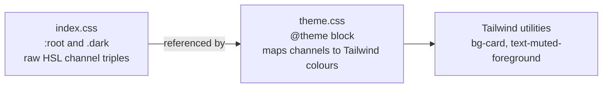
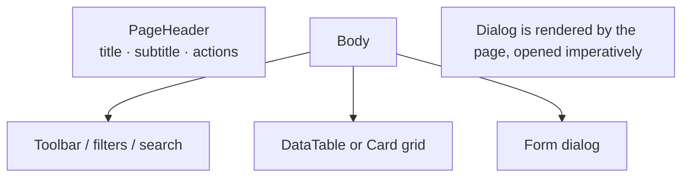

# Design System

The visual language of Opal Line Billing: the tokens, the primitives, and the
page patterns. Everything here already exists in the codebase — this document
explains how to use it and, more importantly, how **not** to fight it.

---

## 1. The brand in one line

**Midnight navy + gold.** Navy carries the interface because it stays legible
behind dense data tables, where a lighter brand hue washes out at small sizes.
Gold is the accent and is used sparingly — on the active nav item and primary
actions — because gold at large areas reads cheap rather than premium.

That single decision governs everything else on this page.

---

## 2. Where the tokens live

Tailwind 4 is **CSS-first**: there is no `tailwind.config.js`. The tokens are
split across two files, and both must agree.



| File | Holds |
|---|---|
| `frontend/src/index.css` | The runtime variables — `:root` (light) and `.dark` — as bare HSL channel triples, plus the `@media print` block |
| `frontend/src/theme.css` | The `@theme` block that maps each variable to a Tailwind colour, plus radii, shadows, fonts and animations |

A token is a **triple** (`222 64% 28%`), not a colour, because the utilities
consume it through `hsl(var(--token))`. Writing `hsl(var(--primary))` yourself
in a component is a bug — use `bg-primary`.

> **Tailwind 4 silently drops tokens it cannot find.** It does not error. After
> editing the theme, verify that `--primary`, `--radius` and the `.dark` block
> still reach the built CSS.

---

## 3. Colour

### 3.1 Semantic tokens

Use these in components. Never reach for a raw palette colour to express
meaning.

| Token | Tailwind class | Use for |
|---|---|---|
| `background` / `foreground` | `bg-background`, `text-foreground` | Page canvas, default text |
| `card` / `card-foreground` | `bg-card`, `text-card-foreground` | Surfaces: cards, panels, inputs |
| `popover` | `bg-popover` | Menus, dropdowns, tooltips |
| `primary` | `bg-primary`, `text-primary` | Primary actions, active state |
| `secondary` | `bg-secondary` | Secondary surfaces |
| `muted` / `muted-foreground` | `text-muted-foreground` | Secondary text, help copy |
| `accent` | `bg-accent` | Hover/active highlight surfaces |
| `destructive` | `bg-destructive` | Delete, danger |
| `border` / `input` / `ring` | `border-border`, `ring-ring` | Borders, focus rings |
| `success`, `warning`, `info` | `bg-success-50`, `text-success-700` | Status semantics (each has a 50/100/700 ramp) |
| `gold` | `bg-gold`, `text-gold` | The premium accent — active nav item, brand moments |
| `sidebar*` | `bg-sidebar`, `text-sidebar-muted` | The left navigation |

### 3.2 Status ramps

Success, warning and info each ship a three-step ramp used consistently:

```
bg-success-50  text-success-700   → a green badge / soft chip
bg-success-100                   → a stronger chip background
bg-success                      → a solid green fill (button)
```

The `Badge` component exposes this as `variant="success" | "warning" | "info" |
"danger"`. Use the badge, not hand-built colour classes.

### 3.3 The gold ramp

Deliberately not a full ramp — only four values exist:

| Token | Use |
|---|---|
| `--gold` | The active sidebar item, brand highlights |
| `--gold-foreground` | Text on a gold fill |
| `--gold-muted` | A soft gold surface |
| `--gold-border` | A gold hairline |

### 3.4 Light, dark and print

- Dark mode is class-based: the `dark` class on `<html>`, toggled by
  `frontend/src/lib/theme.ts` and persisted in `localStorage` under
  `opal-theme`.
- Dark mode is declared as
  `@custom-variant dark (&:where(.dark, .dark *))` in `theme.css` (the v4
  equivalent of v3's `darkMode: ['class']`).
- **Print always uses the light palette.** The `@media print` block in
  `index.css` re-declares the light values over `html.dark`. A dark-mode
  invoice printing with a dark background is a bug, not a preference.
- `scripts/check-palette.mjs` measures WCAG AA contrast across light, dark and
  print in CI. A colour tweak that fails the contrast gate fails the build.

### 3.5 Contrast

Text on its background must reach **4.5:1** (normal text) or **3:1** (large
text and UI borders). The palette in `index.css` is tuned for this; run
`node scripts/check-palette.mjs` after any colour edit rather than eyeballing
it.

---

## 4. Typography

| Role | Class | Notes |
|---|---|---|
| Page title | `text-xl font-bold tracking-tight` | `PageHeader` |
| Card title | `font-semibold leading-none tracking-tight` | `CardTitle` |
| Body | `text-sm` | The default in most of the app |
| Secondary body | `text-sm text-muted-foreground` | Subtitles, help text |
| Label / meta | `text-xs` | Column headers, badges, captions |
| KPI value | `text-[22px] font-bold tracking-tight` | `StatCard` |
| Tiny | `text-2xs` | `--text-2xs: 0.6875rem` — used sparingly |

Font stack: **Inter**, falling back to the system stack
(`--font-sans` in `theme.css`). Monospace is `ui-monospace, SFMono-Regular,
Menlo, Consolas, monospace` (`--font-mono`) — used for SKUs, GSTINs and
barcodes.

> Do not set font sizes inline with arbitrary values. If a size is missing,
> add it to `theme.css` and use it everywhere.

---

## 5. Spacing, radius and elevation

- **Radius**: `--radius: 0.5rem` (8px) is the base. `theme.css` derives
  `sm` (base − 4px), `md` (base − 2px), `lg` (base) and `xl` (base + 4px).
  Cards and panels use `rounded-lg`; inputs and buttons use `rounded-md`;
  badges use `rounded-md`; pills use `rounded-full`.
- **Elevation**: `--shadow-card` (subtle), `--shadow-card-hover` (lifted),
  `--shadow-popover` (menus), `--shadow-kpi` (stat cards). Use the token —
  `shadow-card`, `shadow-popover` — not an arbitrary shadow.
- **Spacing**: Tailwind's default scale. Page gutters are `px-4 lg:px-6`;
  the content column is `max-w-[1100px]` where a page needs a hard edge.

---

## 6. Motion

| Token | Duration | Use |
|---|---|---|
| `--animate-fade-in` | 0.2s | Lists, panels appearing |
| `--animate-scale-in` | 0.15s | Popovers, small surfaces |
| `--animate-dialog-in` | 0.12s | Dialogs |
| `--animate-overlay-in` | 0.12s | Dialog overlays |
| `--animate-slide-in-right` | 0.25s | Toasts, slide-over panels |

**Dialogs must feel instant.** The `dialog-in` keyframes animate opacity and
scale only — **no translate**. The dialog is centred with Tailwind's
`-translate-x-1/2 -translate-y-1/2`, which sets the standalone `translate`
property; a `transform: translate(-50%, -50%)` inside the keyframes would
*stack* on top of it and shift the dialog to the top-left for the length of
the animation. Scale composes after the translate and scales around the
centred box, so it is safe.

Keep animations under 0.25s. Anything longer feels sluggish on a desktop app
running on shop hardware.

---

## 7. Components

All primitives live in `frontend/src/components/ui/`. They are built on Radix
UI with CVA variants and Tailwind tokens.

### 7.1 The primitives

| Component | Variants | Notes |
|---|---|---|
| `Button` | `default`, `secondary`, `outline`, `ghost`, `link`, `destructive`, `success`, `soft-primary`, `soft-danger` × sizes `default`, `sm`, `lg`, `icon`, `icon-sm` | `asChild` renders the child element with the button's classes |
| `Card` | — | `CardHeader`, `CardTitle`, `CardDescription`, `CardContent`, `CardFooter` |
| `Badge` | `default`, `solid`, `secondary`, `outline`, `success`, `warning`, `danger`, `info`, `muted`, `purple` + `dot` | `dot` renders a status dot |
| `Input` | — | `h-9`, `border-input`, `bg-card`, focus ring |
| `Dialog` | — | Radix; `app-dialog.tsx` is the app-specific wrapper |
| `DataTable` | — | TanStack Table v9 with sorting, filtering, selection, column visibility |
| `StatCard` | accents `purple`, `green`, `orange`, `red`, `blue`, `slate` | KPI tile with trend arrow, delta and label |
| `PageHeader` | — | Title, subtitle, actions |
| `EmptyState` | — | Icon, title, description, action |
| `Select`, `SearchableSelect`, `CreatableSelect` | — | Radix Select / listbox variants |
| `Tabs`, `Switch`, `Progress`, `Tooltip`, `Avatar`, `Separator`, `Skeleton`, `Label`, `Textarea` | — | Thin wrappers over Radix |
| `confirm.tsx` + `confirm-hosts.tsx` | — | The app's confirm dialog and toast host, mounted once in `App.tsx` |

### 7.2 Button choice

| Intent | Variant |
|---|---|
| The one action on the page | `default` |
| A second action | `outline` or `secondary` |
| A destructive action | `destructive` |
| A tertiary/icon action | `ghost` |
| A navigation link | `link` |
| A positive completion | `success` |

Do not put two `default` buttons next to each other. If a page seems to need
two, one of them is `outline`.

### 7.3 Tables

`DataTable` handles sorting, column filters, column visibility, row selection
and the empty/loading states. Pages configure columns and stop there.

```tsx
<DataTable
  columns={columns}
  data={rows}
  onRowClick={handleOpen}
  emptyMessage="No invoices in this range"
/>
```

Column alignment goes through the column meta:

```ts
columnMeta: { align?: 'left' | 'right' | 'center'; headerClassName?: string }
```

Right-align every numeric column. Money and weights are compared by position,
not by reading.

### 7.4 Empty and loading states

Every table and list has three states, and all three are designed:

- **Loading** — a `Skeleton` matching the final layout, not a spinner over an
  empty box.
- **Empty** — `EmptyState` with an icon, a sentence saying *why* it is empty
  and, where useful, the action that fills it.
- **Error** — the error is stated; a failed load never renders as "no data".

### 7.5 Confirmations

Destructive and irreversible actions go through the shared confirm host, not a
bare `window.confirm`. `confirmDialog` resolves to a boolean; `promptDialog`
resolves to a string or `null`:

```ts
import { confirmDialog } from '@/components/ui/confirm'

const ok = await confirmDialog({
  title: 'Delete this invoice?',
  description: 'This cannot be undone.',
  confirmLabel: 'Delete',
})

if (!ok) return
```

Toasts go through the same module's `toast` helper (`toast.success(...)`,
`toast.error(...)`), which the `ToastHost` renders. Both hosts are mounted
once in `App.tsx`, so a page never renders its own toast container.

---

## 8. Page anatomy

Every page follows the same skeleton:



- **Title** — the noun, plural where it is a list ("Sales Invoices").
- **Subtitle** — the scope or a one-line explanation, in
  `text-muted-foreground`.
- **Actions** — on the right, in `PageHeader`'s `actions` slot.
- **Filters** — a toolbar above the table, left-aligned, with the range
  selector first when one applies.

### 8.1 Spacing rhythm

| Gap | Use |
|---|---|
| `gap-2` | Between controls in a toolbar |
| `gap-3` | Between form fields |
| `gap-4` | Between sections of a page |
| `space-y-4` / `space-y-6` | Vertical rhythm between stacked blocks |

### 8.2 Responsiveness

The app is used on shop desktops and laptops, but the layout still holds at
tablet width. Use the `lg:` breakpoint for the sidebar collapse and for
page-gutter changes. Do not design a separate mobile layout — there isn't one.

---

## 9. Iconography

- `lucide-react` only. One icon set across the app.
- Icons are `h-4 w-4` inside buttons, `h-5 w-5` in nav items, `h-6 w-6` in
  `EmptyState`.
- Icons in buttons inherit `text-current` and are sized by the button's own
  `[&_svg]:size-4` rule — do not add a size class on the icon.
- An icon never carries meaning alone. Icon-only buttons need an
  `aria-label` or a tooltip.

---

## 10. Accessibility

- Every interactive element is reachable by keyboard and has a visible focus
  ring (`focus-visible:ring-2 focus-visible:ring-ring`).
- Disabled controls use `disabled:pointer-events-none disabled:opacity-50` so
  they still announce as disabled.
- Colour is never the only signal — a status badge has text, a trend has an
  arrow, a chart has a legend.
- Contrast is measured in CI (`scripts/check-palette.mjs`), not eyeballed.

---

## 11. Charts

`recharts`, with the shared theme in
`frontend/src/components/charts/chart-theme.ts` and the shared tooltip in
`chart-tooltip.tsx`. Use those rather than hand-rolling a chart style, so
every chart in the app reads as one family.

Chart colours come from the same semantic tokens as the rest of the UI, and a
chart must state its unit and its range in the surrounding card.

---

## 12. Do / Don't

| Do | Don't |
|---|---|
| Use `bg-card`, `text-muted-foreground` | Use `bg-white`, `text-gray-500` |
| Use the `Badge` variant for status | Hand-build a coloured pill |
| Use `DataTable` for tabular data | Build a `<table>` by hand |
| Use `formatCurrency` / `formatWeight` | Call `toFixed()` inline |
| Use `PageHeader` | Repeat the header markup per page |
| Merge classes with `cn()` | Concatenate strings |
| Use `EmptyState` | Render an empty `<div>` |
| Keep the gold accent rare | Use gold as a button fill everywhere |
